 

### `01 / MANIFESTO`

> **The skill isn't typing code anymore. It's knowing what to ask for.**
>
> I turn ideas into working products by directing AI —
> models plan it, agents build it, I steer, test and ship it.
> No idea is too big, no stack is off-limits.

 

### `02 / LOADOUT`

 

### `03 / WHAT I SHIP`

 

### `04 / PROMPT → PRODUCT`

<table>
  <tr>
    <td width="50%"></td>
    <td width="50%"></td>
  </tr>
  <tr>
    <td width="50%"></td>
    <td width="50%"></td>
  </tr>
</table>

 

### `05 / MACHINE LOG`

<picture>
  <source media="(prefers-color-scheme: dark)" srcset="https://raw.githubusercontent.com/Bankkyz/Bankkyz/output/snake-dark.svg" />
  <source media="(prefers-color-scheme: light)" srcset="https://raw.githubusercontent.com/Bankkyz/Bankkyz/output/snake.svg" />
  
</picture>

↻ regenerated daily by GitHub Actions — even this profile runs itself.

  

### `06 / HAVE AN IDEA?`

