<div align="center">



<a href="https://github.com/Bankkyz"></a>

</div>


##  `> whoami`

```ts
const bankkyz = {
  role:      "Frontend Developer",
  base:      "Thailand · UTC+7",
  building:  ["web apps", "online shops", "POS systems"],
  loves:     ["clean UI", "motion & visuals", "shipping to Vercel"],
  status:    "learning something new every week ✨",
};
```

##  `> sudo install --tech-stack`



##  `> featured_builds --live`

<table>
  <tr>
    <td width="50%"><a href="https://posrng.vercel.app"></a></td>
    <td width="50%"><a href="https://naraishop.vercel.app"></a></td>
  </tr>
  <tr>
    <td width="50%"><a href="https://github.com/Bankkyz/promediafx-portfolio"></a></td>
    <td width="50%"><a href="https://github.com/Bankkyz/Love-Memory"></a></td>
  </tr>
</table>

##  `> system.scan(performance)`



<p align="center"><sub>🛰️ synced daily by GitHub Actions · numbers straight from the GitHub GraphQL API</sub></p>

##  `> contribution_snake.run()`

<picture>
  <source media="(prefers-color-scheme: dark)" srcset="https://raw.githubusercontent.com/Bankkyz/Bankkyz/output/snake-dark.svg" />
  <source media="(prefers-color-scheme: light)" srcset="https://raw.githubusercontent.com/Bankkyz/Bankkyz/output/snake.svg" />
  
</picture>

##  `> establish --connection`

<div align="center">

<a href="https://github.com/Bankkyz"></a>
<a href="https://posrng.vercel.app"></a>

<br/><br/>


</div>
